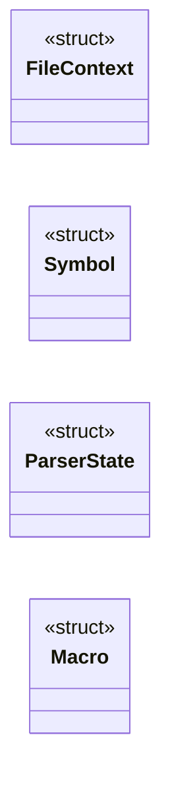
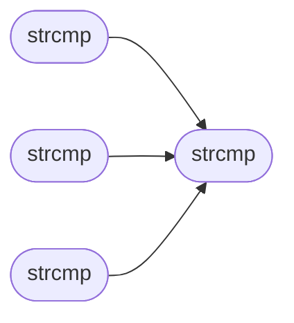

# `minigcc.c`

> Source: [minigcc.c:1](../../minigcc.c#L1) | language `c` | coverage 11.4% | [API index](../index.md)

## Contents

- **Structs:** [`FileContext`](#filecontext), [`Symbol`](#symbol), [`ParserState`](#parserstate), [`Macro`](#macro)
- **Functions:** [`strcmp`](#strcmp), [`strcmp`](#strcmp), [`strcmp`](#strcmp), [`strcmp`](#strcmp), [`strcmp`](#strcmp), [`main`](#main)
- **Macros:** [`MAX_TOKEN_LEN`](#max_token_len), [`MAX_SYMBOLS`](#max_symbols), [`MAX_IDENT_LEN`](#max_ident_len), [`MAX_SOURCE_SIZE`](#max_source_size), [`MAX_INCLUDE_DEPTH`](#max_include_depth), [`MAX_PROCESSED_FILES`](#max_processed_files), [`STACK_ALIGN`](#stack_align), [`LEX_KW_CAP`](#lex_kw_cap), [`LEX_KW_BLOB`](#lex_kw_blob), [`HASH_TABLE_SIZE`](#hash_table_size), [`MAX_SCOPE_DEPTH`](#max_scope_depth), [`MAX_FLOAT_CONSTS`](#max_float_consts), [`MAX_CASES_PER_SWITCH`](#max_cases_per_switch), [`MAX_STRINGS`](#max_strings), [`MAX_PTR_INITS`](#max_ptr_inits), [`MAX_STRUCT_MEMBERS`](#max_struct_members), [`MAX_STRUCT_TYPEDEFS`](#max_struct_typedefs), [`MAX_DEFINED_FUNCS`](#max_defined_funcs), [`MAX_IF_NESTING`](#max_if_nesting), [`CONST_VAR_FLAG`](#const_var_flag), [`MAX_MACROS`](#max_macros), [`ASM_MAX_OPS`](#asm_max_ops), [`ASM_TMPL_SZ`](#asm_tmpl_sz), [`ASM_TXT_SZ`](#asm_txt_sz)

## Type Diagram



## Call Graph

Solid arrows stay in this module, dashed arrows leave it.



## Structs

<a id="filecontext"></a>

### `FileContext`

`struct` | [minigcc.c:98](../../minigcc.c#L98)

```c
typedef struct
```

---

<a id="symbol"></a>

### `Symbol`

`struct` | [minigcc.c:111](../../minigcc.c#L111)

```c
typedef struct
```

---

<a id="parserstate"></a>

### `ParserState`

`struct` | [minigcc.c:272](../../minigcc.c#L272)

```c
typedef struct
```

---

<a id="macro"></a>

### `Macro`

`struct` | [minigcc.c:363](../../minigcc.c#L363)

```c
typedef struct
```

---

## Functions

<a id="strcmp"></a>

### `strcmp`

`function` | [minigcc.c:2183](../../minigcc.c#L2183)

```c
strcmp(id_name, "__sync_lock_test_and_set") == 0 || strcmp(id_name, "__sync_lock_...
```

**Parameters**

| Name | Type | Default | Description |
|---|---|---|---|
| `__sync_lock_test_and_set` |  |  |  |

*Called by:* [`strcmp`](#strcmp), [`strcmp`](#strcmp), [`strcmp`](#strcmp)

---

<a id="strcmp"></a>

### `strcmp`

`function` | [minigcc.c:2188](../../minigcc.c#L2188)

```c
strcmp(id_name, "va_start") == 0)
```

**Parameters**

| Name | Type | Default | Description |
|---|---|---|---|
| `va_start` |  |  |  |

*Calls:* [`strcmp`](#strcmp)

---

<a id="strcmp"></a>

### `strcmp`

`function` | [minigcc.c:2191](../../minigcc.c#L2191)

```c
strcmp(id_name, "va_end") == 0)
```

**Parameters**

| Name | Type | Default | Description |
|---|---|---|---|
| `va_end` |  |  |  |

*Calls:* [`strcmp`](#strcmp)

---

<a id="strcmp"></a>

### `strcmp`

`function` | [minigcc.c:2194](../../minigcc.c#L2194)

```c
strcmp(id_name, "va_arg") == 0)
```

**Parameters**

| Name | Type | Default | Description |
|---|---|---|---|
| `va_arg` |  |  |  |

*Calls:* [`strcmp`](#strcmp)

---

<a id="strcmp"></a>

### `strcmp`

`function` | [minigcc.c:4072](../../minigcc.c#L4072)

```c
strcmp(token, "returns_twice") == 0 || strcmp(token, "always_inline") == 0)
```

**Parameters**

| Name | Type | Default | Description |
|---|---|---|---|
| `returns_twice` |  |  |  |

---

<a id="main"></a>

### `main`

`function` | [minigcc.c:5958](../../minigcc.c#L5958)

```c
int main(int argc, char **argv)
```

**Parameters**

| Name | Type | Default | Description |
|---|---|---|---|
| `argc` | `int` |  |  |
| `argv` | `char **` |  |  |

**Returns:** `int`

---

## Macros

<a id="max_token_len"></a>

### `MAX_TOKEN_LEN`

`macro` | [minigcc.c:15](../../minigcc.c#L15)

```c
#define MAX_TOKEN_LEN
```

---

<a id="max_symbols"></a>

### `MAX_SYMBOLS`

`macro` | [minigcc.c:16](../../minigcc.c#L16)

```c
#define MAX_SYMBOLS
```

---

<a id="max_ident_len"></a>

### `MAX_IDENT_LEN`

`macro` | [minigcc.c:17](../../minigcc.c#L17)

```c
#define MAX_IDENT_LEN
```

---

<a id="max_source_size"></a>

### `MAX_SOURCE_SIZE`

`macro` | [minigcc.c:18](../../minigcc.c#L18)

```c
#define MAX_SOURCE_SIZE
```

---

<a id="max_include_depth"></a>

### `MAX_INCLUDE_DEPTH`

`macro` | [minigcc.c:19](../../minigcc.c#L19)

```c
#define MAX_INCLUDE_DEPTH
```

---

<a id="max_processed_files"></a>

### `MAX_PROCESSED_FILES`

`macro` | [minigcc.c:20](../../minigcc.c#L20)

```c
#define MAX_PROCESSED_FILES
```

---

<a id="stack_align"></a>

### `STACK_ALIGN`

`macro` | [minigcc.c:21](../../minigcc.c#L21)

```c
#define STACK_ALIGN
```

---

<a id="lex_kw_cap"></a>

### `LEX_KW_CAP`

`macro` | [minigcc.c:83](../../minigcc.c#L83)

```c
#define LEX_KW_CAP
```

---

<a id="lex_kw_blob"></a>

### `LEX_KW_BLOB`

`macro` | [minigcc.c:84](../../minigcc.c#L84)

```c
#define LEX_KW_BLOB
```

---

<a id="hash_table_size"></a>

### `HASH_TABLE_SIZE`

`macro` | [minigcc.c:163](../../minigcc.c#L163)

```c
#define HASH_TABLE_SIZE
```

Hash table for O(1) symbol lookup

---

<a id="max_scope_depth"></a>

### `MAX_SCOPE_DEPTH`

`macro` | [minigcc.c:166](../../minigcc.c#L166)

```c
#define MAX_SCOPE_DEPTH
```

---

<a id="max_float_consts"></a>

### `MAX_FLOAT_CONSTS`

`macro` | [minigcc.c:198](../../minigcc.c#L198)

```c
#define MAX_FLOAT_CONSTS
```

---

<a id="max_cases_per_switch"></a>

### `MAX_CASES_PER_SWITCH`

`macro` | [minigcc.c:203](../../minigcc.c#L203)

```c
#define MAX_CASES_PER_SWITCH
```

---

<a id="max_strings"></a>

### `MAX_STRINGS`

`macro` | [minigcc.c:215](../../minigcc.c#L215)

```c
#define MAX_STRINGS
```

---

<a id="max_ptr_inits"></a>

### `MAX_PTR_INITS`

`macro` | [minigcc.c:224](../../minigcc.c#L224)

```c
#define MAX_PTR_INITS
```

Pointer globals initialized with a string literal cannot hold the address at rest: the output is position independent and carries no load-time relocations, so an absolute address baked into .data would be wrong once the image is loaded anywhere but its link address.

The slot is defined as zero and filled in with rip-relative code emitted into _start.

---

<a id="max_struct_members"></a>

### `MAX_STRUCT_MEMBERS`

`macro` | [minigcc.c:234](../../minigcc.c#L234)

```c
#define MAX_STRUCT_MEMBERS
```

Members of ALL structs accumulate into one global table (see skip_struct), so this must exceed the sum of members across every struct in the program, not the size of the largest single struct.

Symbol + ParserState + Macro already total 33, which overflowed the old value of 32 and silently dropped Macro.value, breaking every macro lookup.

---

<a id="max_struct_typedefs"></a>

### `MAX_STRUCT_TYPEDEFS`

`macro` | [minigcc.c:250](../../minigcc.c#L250)

```c
#define MAX_STRUCT_TYPEDEFS
```

Typedef names that denote struct types.

A member declared with one of these keeps the base address in %rax for chained access instead of being loaded as a scalar (which silently miscompiled a.b.c for structs of 8 bytes or less). Pointer declarators clear struct-ness at use sites.

---

<a id="max_defined_funcs"></a>

### `MAX_DEFINED_FUNCS`

`macro` | [minigcc.c:254](../../minigcc.c#L254)

```c
#define MAX_DEFINED_FUNCS
```

---

<a id="max_if_nesting"></a>

### `MAX_IF_NESTING`

`macro` | [minigcc.c:259](../../minigcc.c#L259)

```c
#define MAX_IF_NESTING
```

---

<a id="const_var_flag"></a>

### `CONST_VAR_FLAG`

`macro` | [minigcc.c:260](../../minigcc.c#L260)

```c
#define CONST_VAR_FLAG
```

---

<a id="max_macros"></a>

### `MAX_MACROS`

`macro` | [minigcc.c:269](../../minigcc.c#L269)

```c
#define MAX_MACROS
```

---

<a id="asm_max_ops"></a>

### `ASM_MAX_OPS`

`macro` | [minigcc.c:3697](../../minigcc.c#L3697)

```c
#define ASM_MAX_OPS
```

---

<a id="asm_tmpl_sz"></a>

### `ASM_TMPL_SZ`

`macro` | [minigcc.c:3698](../../minigcc.c#L3698)

```c
#define ASM_TMPL_SZ
```

---

<a id="asm_txt_sz"></a>

### `ASM_TXT_SZ`

`macro` | [minigcc.c:3699](../../minigcc.c#L3699)

```c
#define ASM_TXT_SZ
```

---
