# `minigccg2.s`

> Source: [minigccg2.s:1](../../minigccg2.s#L1) | language `s` | coverage 0.0% | [API index](../index.md)

## Contents

- **Functions:** [`lex_kw_blob`](#lex_kw_blob), [`lex_kw_ids`](#lex_kw_ids), [`lex_kw_count`](#lex_kw_count), [`lex_pass_top`](#lex_pass_top), [`input_ptr`](#input_ptr), [`source_start`](#source_start), [`token`](#token), [`tok`](#tok), [`line`](#line), [`output`](#output), [`ctx_stack`](#ctx_stack), [`ctx_top`](#ctx_top), [`current_file`](#current_file), [`processed_files`](#processed_files), [`processed_count`](#processed_count), [`symbols`](#symbols), [`symbol_count`](#symbol_count), [`static_local_count`](#static_local_count), [`sym_label`](#sym_label), [`build_static_label`](#build_static_label), [`hash_table`](#hash_table), [`scope_stack_sym`](#scope_stack_sym), [`scope_stack_stk`](#scope_stack_stk), [`scope_depth`](#scope_depth), [`stack_size`](#stack_size), [`label_counter`](#label_counter), [`function_has_return`](#function_has_return), [`emit_enabled`](#emit_enabled), [`max_func_stack`](#max_func_stack), [`assign_size`](#assign_size), [`expr_pointed`](#expr_pointed), [`expr_fnptr`](#expr_fnptr), [`subscript_base_fnptr`](#subscript_base_fnptr), [`current_elem_size`](#current_elem_size), [`current_elem_size2`](#current_elem_size2), [`current_elem_unsigned`](#current_elem_unsigned), [`deref_w`](#deref_w), [`deref_u`](#deref_u), [`no_postfix_deref`](#no_postfix_deref), [`expr_type`](#expr_type), [`expr_unsigned`](#expr_unsigned), [`static_flag`](#static_flag), [`unsigned_type`](#unsigned_type), [`const_flag`](#const_flag), [`extern_flag`](#extern_flag), [`global_emit_deferred`](#global_emit_deferred), [`pending_align`](#pending_align), [`func_is_variadic`](#func_is_variadic), [`vararg_nfixed`](#vararg_nfixed), [`vararg_save_off`](#vararg_save_off), [`float_const_str`](#float_const_str), [`float_const_is_float`](#float_const_is_float), [`float_const_count`](#float_const_count), [`switch_case_values`](#switch_case_values), [`switch_case_labels`](#switch_case_labels), [`switch_case_count`](#switch_case_count), [`switch_has_default`](#switch_has_default), [`switch_default_label`](#switch_default_label), [`break_target`](#break_target), [`break_target_valid`](#break_target_valid), [`continue_target`](#continue_target), [`continue_target_valid`](#continue_target_valid), [`str_label_counter`](#str_label_counter), [`string_pool`](#string_pool), [`string_count`](#string_count), [`ptr_init_name`](#ptr_init_name), [`ptr_init_label`](#ptr_init_label), [`ptr_init_count`](#ptr_init_count), [`struct_total_size`](#struct_total_size), [`struct_member_names`](#struct_member_names), [`struct_member_offsets`](#struct_member_offsets), [`struct_member_sizes`](#struct_member_sizes), [`struct_member_elem_sizes`](#struct_member_elem_sizes), [`struct_member_unsigned`](#struct_member_unsigned), [`struct_member_is_float`](#struct_member_is_float), [`struct_member_is_fnptr`](#struct_member_is_fnptr), [`struct_member_is_struct`](#struct_member_is_struct), [`struct_member_count`](#struct_member_count), [`struct_typedef_names`](#struct_typedef_names), [`struct_typedef_count`](#struct_typedef_count), [`defined_func_names`](#defined_func_names), [`defined_func_unsigned`](#defined_func_unsigned), [`defined_func_count`](#defined_func_count), [`if_nest`](#if_nest), [`if_taken`](#if_taken), [`if_depth`](#if_depth), [`macro_count`](#macro_count), [`save_parser_state`](#save_parser_state), [`restore_parser_state`](#restore_parser_state), [`macros`](#macros), [`find_macro`](#find_macro), [`add_macro`](#add_macro), [`macro_p`](#macro_p), [`macro_ok`](#macro_ok), [`macro_undef_zero`](#macro_undef_zero), [`macro_skipws`](#macro_skipws), [`macro_hex_digit`](#macro_hex_digit), [`macro_digit_val`](#macro_digit_val), [`macro_primary`](#macro_primary), [`macro_unary`](#macro_unary), [`macro_mul`](#macro_mul), [`macro_add`](#macro_add), [`macro_shift`](#macro_shift), [`macro_cmp`](#macro_cmp), [`macro_eq`](#macro_eq), [`macro_bitand`](#macro_bitand), [`macro_bitxor`](#macro_bitxor), [`macro_bitor`](#macro_bitor), [`macro_logand`](#macro_logand), [`macro_or_expr`](#macro_or_expr), [`macro_fold`](#macro_fold), [`error`](#error), [`pp_eval`](#pp_eval), [`safe_malloc`](#safe_malloc), [`safe_strcpy`](#safe_strcpy), [`ident_copy`](#ident_copy), [`is_struct_typedef`](#is_struct_typedef), [`record_struct_typedef`](#record_struct_typedef), [`safe_strtoll`](#safe_strtoll), [`is_file_processed`](#is_file_processed), [`mark_file_processed`](#mark_file_processed), [`get_dir_from_path`](#get_dir_from_path), [`resolve_local_include`](#resolve_local_include), [`read_include_file`](#read_include_file), [`hash_name`](#hash_name), [`hash_init`](#hash_init), [`push_scope`](#push_scope), [`pop_scope`](#pop_scope), [`truncate_symbols`](#truncate_symbols), [`my_isspace`](#my_isspace), [`my_isalpha`](#my_isalpha), [`my_isdigit`](#my_isdigit), [`my_isalnum`](#my_isalnum), [`lex_fail`](#lex_fail), [`lex_kw_add`](#lex_kw_add), [`lex_init_keywords`](#lex_init_keywords), [`lex_kw_lookup`](#lex_kw_lookup), [`lex_match_op`](#lex_match_op), [`lex_hex_val`](#lex_hex_val), [`lex_is_int_suffix`](#lex_is_int_suffix), [`lex_number`](#lex_number), [`next_token`](#next_token), [`restart`](#restart), [`match`](#match), [`emit`](#emit), [`emit_i`](#emit_i), [`emit_s`](#emit_s), [`emit_is`](#emit_is), [`emit_si`](#emit_si), [`emit_asciz_body`](#emit_asciz_body), [`emit_label`](#emit_label), [`find_symbol`](#find_symbol), [`add_symbol`](#add_symbol), [`arg_reg`](#arg_reg), [`note_defined_func`](#note_defined_func), [`is_defined_func`](#is_defined_func), [`func_return_unsigned`](#func_return_unsigned), [`parse_fnptr_declarator`](#parse_fnptr_declarator), [`peek_call_argc`](#peek_call_argc), [`emit_spill_reverse`](#emit_spill_reverse), [`parse_indirect_call`](#parse_indirect_call), [`libc_global_name`](#libc_global_name), [`typedef_name`](#typedef_name), [`typedef_size`](#typedef_size), [`typedef_uns`](#typedef_uns), [`unary`](#unary), [`parse_sync_call`](#parse_sync_call), [`parse_va_start`](#parse_va_start), [`parse_va_arg`](#parse_va_arg), [`parse_va_end`](#parse_va_end), [`lvalue_address`](#lvalue_address), [`postfix_member`](#postfix_member), [`handle_postfix`](#handle_postfix), [`unary_expr`](#unary_expr), [`multiplicative_expr`](#multiplicative_expr), [`additive_expr`](#additive_expr), [`shift_expr`](#shift_expr), [`relational_expr`](#relational_expr), [`equality_expr`](#equality_expr), [`bitwise_and_expr`](#bitwise_and_expr), [`bitwise_xor_expr`](#bitwise_xor_expr), [`bitwise_or_expr`](#bitwise_or_expr), [`logical_and_expr`](#logical_and_expr), [`logical_or_expr`](#logical_or_expr), [`conditional_expr`](#conditional_expr), [`emit_compound_op`](#emit_compound_op), [`assignment_expr`](#assignment_expr), [`comma_expr`](#comma_expr), [`asm_tmpl`](#asm_tmpl), [`asm_text`](#asm_text), [`asm_mem`](#asm_mem), [`asm_is_out`](#asm_is_out), [`asm_home`](#asm_home), [`asm_slot`](#asm_slot), [`asm_size`](#asm_size), [`asm_nops`](#asm_nops), [`asm_nslots`](#asm_nslots), [`asm_unique`](#asm_unique), [`asm_scratch`](#asm_scratch), [`asm_home_text`](#asm_home_text), [`asm_reg_sized`](#asm_reg_sized), [`asm_fixed_home`](#asm_fixed_home), [`asm_emit_template`](#asm_emit_template), [`asm_parse_mem`](#asm_parse_mem), [`asm_emit_ss`](#asm_emit_ss), [`asm_parse_one`](#asm_parse_one), [`asm_assign_homes`](#asm_assign_homes), [`asm_emit_all`](#asm_emit_all), [`skip_gcc_attribute`](#skip_gcc_attribute), [`parse_trailing_align`](#parse_trailing_align), [`parse_asm_block`](#parse_asm_block), [`statement`](#statement), [`restart_typedef`](#restart_typedef), [`restart_int`](#restart_int), [`parse_function`](#parse_function), [`parse_enum`](#parse_enum), [`skip_struct_fields`](#skip_struct_fields), [`skip_struct`](#skip_struct), [`td_stash_valid`](#td_stash_valid), [`td_stash_size`](#td_stash_size), [`td_stash_uns`](#td_stash_uns), [`td_stash_fnptr`](#td_stash_fnptr), [`record_typedef_alias`](#record_typedef_alias), [`skip_typedef`](#skip_typedef), [`data_directive`](#data_directive), [`emit_global_bss`](#emit_global_bss), [`emit_global_data_head`](#emit_global_data_head), [`parse_const_int`](#parse_const_int), [`intern_string`](#intern_string), [`emit_global_initializer`](#emit_global_initializer), [`parse_program`](#parse_program), [`emit_float_consts`](#emit_float_consts), [`emit_string_pool`](#emit_string_pool), [`main`](#main), [`_start`](#_start)

## Call Graph

Solid arrows stay in this module, dashed arrows leave it.

```mermaid
flowchart LR
    n_minigccg2_s__build_static_label(["build_static_label"])
    n_minigccg2_s__static_local_count(["static_local_count"])
    n_minigccg2_s__save_parser_state(["save_parser_state"])
    n_minigccg2_s__assign_size(["assign_size"])
    n_minigccg2_s__break_target(["break_target"])
    n_minigccg2_s__break_target_valid(["break_target_valid"])
    n_minigccg2_s__continue_target(["continue_target"])
    n_minigccg2_s__continue_target_valid(["continue_target_valid"])
    n_minigccg2_s__current_elem_size(["current_elem_size"])
    n_minigccg2_s__current_elem_size2(["current_elem_size2"])
    n_minigccg2_s__current_elem_unsigned(["current_elem_unsigned"])
    n_minigccg2_s__deref_u(["deref_u"])
    n_minigccg2_s__deref_w(["deref_w"])
    n_minigccg2_s__emit_enabled(["emit_enabled"])
    n_minigccg2_s__expr_pointed(["expr_pointed"])
    n_minigccg2_s__expr_type(["expr_type"])
    n_minigccg2_s__expr_unsigned(["expr_unsigned"])
    n_minigccg2_s__float_const_count(["float_const_count"])
    n_minigccg2_s__function_has_return(["function_has_return"])
    n_minigccg2_s__macro_count(["macro_count"])
    n_minigccg2_s__max_func_stack(["max_func_stack"])
    n_minigccg2_s__no_postfix_deref(["no_postfix_deref"])
    n_minigccg2_s__stack_size(["stack_size"])
    n_minigccg2_s__struct_member_count(["struct_member_count"])
    n_minigccg2_s__struct_total_size(["struct_total_size"])
    n_minigccg2_s__switch_case_count(["switch_case_count"])
    n_minigccg2_s__build_static_label --> n_minigccg2_s__static_local_count
    n_minigccg2_s__save_parser_state --> n_minigccg2_s__assign_size
    n_minigccg2_s__save_parser_state --> n_minigccg2_s__break_target
    n_minigccg2_s__save_parser_state --> n_minigccg2_s__break_target_valid
    n_minigccg2_s__save_parser_state --> n_minigccg2_s__continue_target
    n_minigccg2_s__save_parser_state --> n_minigccg2_s__continue_target_valid
    n_minigccg2_s__save_parser_state --> n_minigccg2_s__current_elem_size
    n_minigccg2_s__save_parser_state --> n_minigccg2_s__current_elem_size2
    n_minigccg2_s__save_parser_state --> n_minigccg2_s__current_elem_unsigned
    n_minigccg2_s__save_parser_state --> n_minigccg2_s__deref_u
    n_minigccg2_s__save_parser_state --> n_minigccg2_s__deref_w
    n_minigccg2_s__save_parser_state --> n_minigccg2_s__emit_enabled
    n_minigccg2_s__save_parser_state --> n_minigccg2_s__expr_pointed
    n_minigccg2_s__save_parser_state --> n_minigccg2_s__expr_type
    n_minigccg2_s__save_parser_state --> n_minigccg2_s__expr_unsigned
    n_minigccg2_s__save_parser_state --> n_minigccg2_s__float_const_count
    n_minigccg2_s__save_parser_state --> n_minigccg2_s__function_has_return
    n_minigccg2_s__save_parser_state --> n_minigccg2_s__macro_count
    n_minigccg2_s__save_parser_state --> n_minigccg2_s__max_func_stack
    n_minigccg2_s__save_parser_state --> n_minigccg2_s__no_postfix_deref
    n_minigccg2_s__save_parser_state --> n_minigccg2_s__stack_size
    n_minigccg2_s__save_parser_state --> n_minigccg2_s__struct_member_count
    n_minigccg2_s__save_parser_state --> n_minigccg2_s__struct_total_size
    n_minigccg2_s__save_parser_state --> n_minigccg2_s__switch_case_count
```



## Functions

<a id="lex_kw_blob"></a>

### `lex_kw_blob`

`function` | [minigccg2.s:3](../../minigccg2.s#L3)

```asm
lex_kw_blob:
```

---

<a id="lex_kw_ids"></a>

### `lex_kw_ids`

`function` | [minigccg2.s:7](../../minigccg2.s#L7)

```asm
lex_kw_ids:
```

---

<a id="lex_kw_count"></a>

### `lex_kw_count`

`function` | [minigccg2.s:11](../../minigccg2.s#L11)

```asm
lex_kw_count:
```

*Called by:* [`lex_init_keywords`](#lex_init_keywords)

---

<a id="lex_pass_top"></a>

### `lex_pass_top`

`function` | [minigccg2.s:15](../../minigccg2.s#L15)

```asm
lex_pass_top:
```

---

<a id="input_ptr"></a>

### `input_ptr`

`function` | [minigccg2.s:19](../../minigccg2.s#L19)

```asm
input_ptr:
```

*Called by:* [`lex_number`](#lex_number), [`peek_call_argc`](#peek_call_argc), [`restart`](#restart)

---

<a id="source_start"></a>

### `source_start`

`function` | [minigccg2.s:23](../../minigccg2.s#L23)

```asm
source_start:
```

---

<a id="token"></a>

### `token`

`function` | [minigccg2.s:27](../../minigccg2.s#L27)

```asm
token:
```

*Called by:* [`unary`](#unary)

---

<a id="tok"></a>

### `tok`

`function` | [minigccg2.s:31](../../minigccg2.s#L31)

```asm
tok:
```

*Called by:* [`match`](#match), [`parse_fnptr_declarator`](#parse_fnptr_declarator), [`peek_call_argc`](#peek_call_argc), [`unary`](#unary)

---

<a id="line"></a>

### `line`

`function` | [minigccg2.s:35](../../minigccg2.s#L35)

```asm
line:
```

*Called by:* [`peek_call_argc`](#peek_call_argc)

---

<a id="output"></a>

### `output`

`function` | [minigccg2.s:39](../../minigccg2.s#L39)

```asm
output:
```

*Called by:* [`emit_label`](#emit_label)

---

<a id="ctx_stack"></a>

### `ctx_stack`

`function` | [minigccg2.s:43](../../minigccg2.s#L43)

```asm
ctx_stack:
```

---

<a id="ctx_top"></a>

### `ctx_top`

`function` | [minigccg2.s:47](../../minigccg2.s#L47)

```asm
ctx_top:
```

---

<a id="current_file"></a>

### `current_file`

`function` | [minigccg2.s:51](../../minigccg2.s#L51)

```asm
current_file:
```

*Called by:* [`error`](#error)

---

<a id="processed_files"></a>

### `processed_files`

`function` | [minigccg2.s:55](../../minigccg2.s#L55)

```asm
processed_files:
```

---

<a id="processed_count"></a>

### `processed_count`

`function` | [minigccg2.s:59](../../minigccg2.s#L59)

```asm
processed_count:
```

*Called by:* [`mark_file_processed`](#mark_file_processed)

---

<a id="symbols"></a>

### `symbols`

`function` | [minigccg2.s:63](../../minigccg2.s#L63)

```asm
symbols:
```

---

<a id="symbol_count"></a>

### `symbol_count`

`function` | [minigccg2.s:67](../../minigccg2.s#L67)

```asm
symbol_count:
```

*Called by:* [`add_symbol`](#add_symbol), [`restore_parser_state`](#restore_parser_state), [`save_parser_state`](#save_parser_state)

---

<a id="static_local_count"></a>

### `static_local_count`

`function` | [minigccg2.s:71](../../minigccg2.s#L71)

```asm
static_local_count:
```

*Called by:* [`build_static_label`](#build_static_label)

---

<a id="sym_label"></a>

### `sym_label`

`function` | [minigccg2.s:75](../../minigccg2.s#L75)

```asm
sym_label:
```

---

<a id="build_static_label"></a>

### `build_static_label`

`function` | [minigccg2.s:100](../../minigccg2.s#L100)

```asm
build_static_label:
```

*Calls:* [`static_local_count`](#static_local_count)

---

<a id="hash_table"></a>

### `hash_table`

`function` | [minigccg2.s:320](../../minigccg2.s#L320)

```asm
hash_table:
```

*Called by:* [`find_symbol`](#find_symbol)

---

<a id="scope_stack_sym"></a>

### `scope_stack_sym`

`function` | [minigccg2.s:324](../../minigccg2.s#L324)

```asm
scope_stack_sym:
```

---

<a id="scope_stack_stk"></a>

### `scope_stack_stk`

`function` | [minigccg2.s:328](../../minigccg2.s#L328)

```asm
scope_stack_stk:
```

---

<a id="scope_depth"></a>

### `scope_depth`

`function` | [minigccg2.s:332](../../minigccg2.s#L332)

```asm
scope_depth:
```

*Called by:* [`pop_scope`](#pop_scope), [`push_scope`](#push_scope)

---

<a id="stack_size"></a>

### `stack_size`

`function` | [minigccg2.s:336](../../minigccg2.s#L336)

```asm
stack_size:
```

*Called by:* [`save_parser_state`](#save_parser_state)

---

<a id="label_counter"></a>

### `label_counter`

`function` | [minigccg2.s:340](../../minigccg2.s#L340)

```asm
label_counter:
```

---

<a id="function_has_return"></a>

### `function_has_return`

`function` | [minigccg2.s:344](../../minigccg2.s#L344)

```asm
function_has_return:
```

*Called by:* [`save_parser_state`](#save_parser_state)

---

<a id="emit_enabled"></a>

### `emit_enabled`

`function` | [minigccg2.s:348](../../minigccg2.s#L348)

```asm
emit_enabled:
```

*Called by:* [`emit`](#emit), [`emit_asciz_body`](#emit_asciz_body), [`emit_i`](#emit_i), [`emit_is`](#emit_is), [`emit_label`](#emit_label), [`emit_s`](#emit_s), [`emit_si`](#emit_si), [`save_parser_state`](#save_parser_state)

---

<a id="max_func_stack"></a>

### `max_func_stack`

`function` | [minigccg2.s:352](../../minigccg2.s#L352)

```asm
max_func_stack:
```

*Called by:* [`save_parser_state`](#save_parser_state)

---

<a id="assign_size"></a>

### `assign_size`

`function` | [minigccg2.s:356](../../minigccg2.s#L356)

```asm
assign_size:
```

*Called by:* [`restore_parser_state`](#restore_parser_state), [`save_parser_state`](#save_parser_state)

---

<a id="expr_pointed"></a>

### `expr_pointed`

`function` | [minigccg2.s:360](../../minigccg2.s#L360)

```asm
expr_pointed:
```

*Called by:* [`restore_parser_state`](#restore_parser_state), [`save_parser_state`](#save_parser_state), [`unary`](#unary)

---

<a id="expr_fnptr"></a>

### `expr_fnptr`

`function` | [minigccg2.s:364](../../minigccg2.s#L364)

```asm
expr_fnptr:
```

*Called by:* [`unary`](#unary)

---

<a id="subscript_base_fnptr"></a>

### `subscript_base_fnptr`

`function` | [minigccg2.s:368](../../minigccg2.s#L368)

```asm
subscript_base_fnptr:
```

---

<a id="current_elem_size"></a>

### `current_elem_size`

`function` | [minigccg2.s:372](../../minigccg2.s#L372)

```asm
current_elem_size:
```

*Called by:* [`restore_parser_state`](#restore_parser_state), [`save_parser_state`](#save_parser_state)

---

<a id="current_elem_size2"></a>

### `current_elem_size2`

`function` | [minigccg2.s:376](../../minigccg2.s#L376)

```asm
current_elem_size2:
```

*Called by:* [`restore_parser_state`](#restore_parser_state), [`save_parser_state`](#save_parser_state)

---

<a id="current_elem_unsigned"></a>

### `current_elem_unsigned`

`function` | [minigccg2.s:380](../../minigccg2.s#L380)

```asm
current_elem_unsigned:
```

*Called by:* [`restore_parser_state`](#restore_parser_state), [`save_parser_state`](#save_parser_state)

---

<a id="deref_w"></a>

### `deref_w`

`function` | [minigccg2.s:384](../../minigccg2.s#L384)

```asm
deref_w:
```

*Called by:* [`restore_parser_state`](#restore_parser_state), [`save_parser_state`](#save_parser_state), [`unary`](#unary)

---

<a id="deref_u"></a>

### `deref_u`

`function` | [minigccg2.s:388](../../minigccg2.s#L388)

```asm
deref_u:
```

*Called by:* [`restore_parser_state`](#restore_parser_state), [`save_parser_state`](#save_parser_state), [`unary`](#unary)

---

<a id="no_postfix_deref"></a>

### `no_postfix_deref`

`function` | [minigccg2.s:392](../../minigccg2.s#L392)

```asm
no_postfix_deref:
```

*Called by:* [`restore_parser_state`](#restore_parser_state), [`save_parser_state`](#save_parser_state)

---

<a id="expr_type"></a>

### `expr_type`

`function` | [minigccg2.s:396](../../minigccg2.s#L396)

```asm
expr_type:
```

*Called by:* [`save_parser_state`](#save_parser_state), [`unary`](#unary)

---

<a id="expr_unsigned"></a>

### `expr_unsigned`

`function` | [minigccg2.s:400](../../minigccg2.s#L400)

```asm
expr_unsigned:
```

*Called by:* [`save_parser_state`](#save_parser_state), [`unary`](#unary)

---

<a id="static_flag"></a>

### `static_flag`

`function` | [minigccg2.s:404](../../minigccg2.s#L404)

```asm
static_flag:
```

---

<a id="unsigned_type"></a>

### `unsigned_type`

`function` | [minigccg2.s:408](../../minigccg2.s#L408)

```asm
unsigned_type:
```

---

<a id="const_flag"></a>

### `const_flag`

`function` | [minigccg2.s:412](../../minigccg2.s#L412)

```asm
const_flag:
```

---

<a id="extern_flag"></a>

### `extern_flag`

`function` | [minigccg2.s:416](../../minigccg2.s#L416)

```asm
extern_flag:
```

---

<a id="global_emit_deferred"></a>

### `global_emit_deferred`

`function` | [minigccg2.s:420](../../minigccg2.s#L420)

```asm
global_emit_deferred:
```

---

<a id="pending_align"></a>

### `pending_align`

`function` | [minigccg2.s:424](../../minigccg2.s#L424)

```asm
pending_align:
```

---

<a id="func_is_variadic"></a>

### `func_is_variadic`

`function` | [minigccg2.s:428](../../minigccg2.s#L428)

```asm
func_is_variadic:
```

---

<a id="vararg_nfixed"></a>

### `vararg_nfixed`

`function` | [minigccg2.s:432](../../minigccg2.s#L432)

```asm
vararg_nfixed:
```

---

<a id="vararg_save_off"></a>

### `vararg_save_off`

`function` | [minigccg2.s:436](../../minigccg2.s#L436)

```asm
vararg_save_off:
```

---

<a id="float_const_str"></a>

### `float_const_str`

`function` | [minigccg2.s:440](../../minigccg2.s#L440)

```asm
float_const_str:
```

---

<a id="float_const_is_float"></a>

### `float_const_is_float`

`function` | [minigccg2.s:444](../../minigccg2.s#L444)

```asm
float_const_is_float:
```

---

<a id="float_const_count"></a>

### `float_const_count`

`function` | [minigccg2.s:448](../../minigccg2.s#L448)

```asm
float_const_count:
```

*Called by:* [`save_parser_state`](#save_parser_state)

---

<a id="switch_case_values"></a>

### `switch_case_values`

`function` | [minigccg2.s:452](../../minigccg2.s#L452)

```asm
switch_case_values:
```

---

<a id="switch_case_labels"></a>

### `switch_case_labels`

`function` | [minigccg2.s:456](../../minigccg2.s#L456)

```asm
switch_case_labels:
```

---

<a id="switch_case_count"></a>

### `switch_case_count`

`function` | [minigccg2.s:460](../../minigccg2.s#L460)

```asm
switch_case_count:
```

*Called by:* [`save_parser_state`](#save_parser_state)

---

<a id="switch_has_default"></a>

### `switch_has_default`

`function` | [minigccg2.s:464](../../minigccg2.s#L464)

```asm
switch_has_default:
```

*Called by:* [`save_parser_state`](#save_parser_state)

---

<a id="switch_default_label"></a>

### `switch_default_label`

`function` | [minigccg2.s:468](../../minigccg2.s#L468)

```asm
switch_default_label:
```

*Called by:* [`save_parser_state`](#save_parser_state)

---

<a id="break_target"></a>

### `break_target`

`function` | [minigccg2.s:472](../../minigccg2.s#L472)

```asm
break_target:
```

*Called by:* [`save_parser_state`](#save_parser_state)

---

<a id="break_target_valid"></a>

### `break_target_valid`

`function` | [minigccg2.s:476](../../minigccg2.s#L476)

```asm
break_target_valid:
```

*Called by:* [`save_parser_state`](#save_parser_state)

---

<a id="continue_target"></a>

### `continue_target`

`function` | [minigccg2.s:480](../../minigccg2.s#L480)

```asm
continue_target:
```

*Called by:* [`save_parser_state`](#save_parser_state)

---

<a id="continue_target_valid"></a>

### `continue_target_valid`

`function` | [minigccg2.s:484](../../minigccg2.s#L484)

```asm
continue_target_valid:
```

*Called by:* [`save_parser_state`](#save_parser_state)

---

<a id="str_label_counter"></a>

### `str_label_counter`

`function` | [minigccg2.s:488](../../minigccg2.s#L488)

```asm
str_label_counter:
```

---

<a id="string_pool"></a>

### `string_pool`

`function` | [minigccg2.s:492](../../minigccg2.s#L492)

```asm
string_pool:
```

---

<a id="string_count"></a>

### `string_count`

`function` | [minigccg2.s:496](../../minigccg2.s#L496)

```asm
string_count:
```

---

<a id="ptr_init_name"></a>

### `ptr_init_name`

`function` | [minigccg2.s:500](../../minigccg2.s#L500)

```asm
ptr_init_name:
```

---

<a id="ptr_init_label"></a>

### `ptr_init_label`

`function` | [minigccg2.s:504](../../minigccg2.s#L504)

```asm
ptr_init_label:
```

---

<a id="ptr_init_count"></a>

### `ptr_init_count`

`function` | [minigccg2.s:508](../../minigccg2.s#L508)

```asm
ptr_init_count:
```

---

<a id="struct_total_size"></a>

### `struct_total_size`

`function` | [minigccg2.s:512](../../minigccg2.s#L512)

```asm
struct_total_size:
```

*Called by:* [`save_parser_state`](#save_parser_state)

---

<a id="struct_member_names"></a>

### `struct_member_names`

`function` | [minigccg2.s:516](../../minigccg2.s#L516)

```asm
struct_member_names:
```

---

<a id="struct_member_offsets"></a>

### `struct_member_offsets`

`function` | [minigccg2.s:520](../../minigccg2.s#L520)

```asm
struct_member_offsets:
```

---

<a id="struct_member_sizes"></a>

### `struct_member_sizes`

`function` | [minigccg2.s:524](../../minigccg2.s#L524)

```asm
struct_member_sizes:
```

---

<a id="struct_member_elem_sizes"></a>

### `struct_member_elem_sizes`

`function` | [minigccg2.s:528](../../minigccg2.s#L528)

```asm
struct_member_elem_sizes:
```

---

<a id="struct_member_unsigned"></a>

### `struct_member_unsigned`

`function` | [minigccg2.s:532](../../minigccg2.s#L532)

```asm
struct_member_unsigned:
```

---

<a id="struct_member_is_float"></a>

### `struct_member_is_float`

`function` | [minigccg2.s:536](../../minigccg2.s#L536)

```asm
struct_member_is_float:
```

---

<a id="struct_member_is_fnptr"></a>

### `struct_member_is_fnptr`

`function` | [minigccg2.s:540](../../minigccg2.s#L540)

```asm
struct_member_is_fnptr:
```

---

<a id="struct_member_is_struct"></a>

### `struct_member_is_struct`

`function` | [minigccg2.s:544](../../minigccg2.s#L544)

```asm
struct_member_is_struct:
```

---

<a id="struct_member_count"></a>

### `struct_member_count`

`function` | [minigccg2.s:548](../../minigccg2.s#L548)

```asm
struct_member_count:
```

*Called by:* [`save_parser_state`](#save_parser_state)

---

<a id="struct_typedef_names"></a>

### `struct_typedef_names`

`function` | [minigccg2.s:552](../../minigccg2.s#L552)

```asm
struct_typedef_names:
```

---

<a id="struct_typedef_count"></a>

### `struct_typedef_count`

`function` | [minigccg2.s:556](../../minigccg2.s#L556)

```asm
struct_typedef_count:
```

---

<a id="defined_func_names"></a>

### `defined_func_names`

`function` | [minigccg2.s:560](../../minigccg2.s#L560)

```asm
defined_func_names:
```

---

<a id="defined_func_unsigned"></a>

### `defined_func_unsigned`

`function` | [minigccg2.s:564](../../minigccg2.s#L564)

```asm
defined_func_unsigned:
```

---

<a id="defined_func_count"></a>

### `defined_func_count`

`function` | [minigccg2.s:568](../../minigccg2.s#L568)

```asm
defined_func_count:
```

---

<a id="if_nest"></a>

### `if_nest`

`function` | [minigccg2.s:572](../../minigccg2.s#L572)

```asm
if_nest:
```

---

<a id="if_taken"></a>

### `if_taken`

`function` | [minigccg2.s:576](../../minigccg2.s#L576)

```asm
if_taken:
```

---

<a id="if_depth"></a>

### `if_depth`

`function` | [minigccg2.s:580](../../minigccg2.s#L580)

```asm
if_depth:
```

---

<a id="macro_count"></a>

### `macro_count`

`function` | [minigccg2.s:585](../../minigccg2.s#L585)

```asm
macro_count:
```

*Called by:* [`add_macro`](#add_macro), [`save_parser_state`](#save_parser_state)

---

<a id="save_parser_state"></a>

### `save_parser_state`

`function` | [minigccg2.s:589](../../minigccg2.s#L589)

```asm
save_parser_state:
```

*Calls:* [`assign_size`](#assign_size), [`break_target`](#break_target), [`break_target_valid`](#break_target_valid), [`continue_target`](#continue_target), [`continue_target_valid`](#continue_target_valid), [`current_elem_size`](#current_elem_size), [`current_elem_size2`](#current_elem_size2), [`current_elem_unsigned`](#current_elem_unsigned), [`deref_u`](#deref_u), [`deref_w`](#deref_w), [`emit_enabled`](#emit_enabled), [`expr_pointed`](#expr_pointed) and 14 more

---

<a id="restore_parser_state"></a>

### `restore_parser_state`

`function` | [minigccg2.s:752](../../minigccg2.s#L752)

```asm
restore_parser_state:
```

*Calls:* [`assign_size`](#assign_size), [`current_elem_size`](#current_elem_size), [`current_elem_size2`](#current_elem_size2), [`current_elem_unsigned`](#current_elem_unsigned), [`deref_u`](#deref_u), [`deref_w`](#deref_w), [`expr_pointed`](#expr_pointed), [`no_postfix_deref`](#no_postfix_deref), [`symbol_count`](#symbol_count)

---

<a id="macros"></a>

### `macros`

`function` | [minigccg2.s:968](../../minigccg2.s#L968)

```asm
macros:
```

---

<a id="find_macro"></a>

### `find_macro`

`function` | [minigccg2.s:972](../../minigccg2.s#L972)

```asm
find_macro:
```

---

<a id="add_macro"></a>

### `add_macro`

`function` | [minigccg2.s:1035](../../minigccg2.s#L1035)

```asm
add_macro:
```

*Calls:* [`macro_count`](#macro_count)

---

<a id="macro_p"></a>

### `macro_p`

`function` | [minigccg2.s:1105](../../minigccg2.s#L1105)

```asm
macro_p:
```

*Called by:* [`macro_primary`](#macro_primary), [`macro_unary`](#macro_unary), [`pp_eval`](#pp_eval)

---

<a id="macro_ok"></a>

### `macro_ok`

`function` | [minigccg2.s:1109](../../minigccg2.s#L1109)

```asm
macro_ok:
```

*Called by:* [`macro_fold`](#macro_fold), [`macro_primary`](#macro_primary), [`pp_eval`](#pp_eval)

---

<a id="macro_undef_zero"></a>

### `macro_undef_zero`

`function` | [minigccg2.s:1113](../../minigccg2.s#L1113)

```asm
macro_undef_zero:
```

*Called by:* [`macro_fold`](#macro_fold), [`pp_eval`](#pp_eval)

---

<a id="macro_skipws"></a>

### `macro_skipws`

`function` | [minigccg2.s:1117](../../minigccg2.s#L1117)

```asm
macro_skipws:
```

---

<a id="macro_hex_digit"></a>

### `macro_hex_digit`

`function` | [minigccg2.s:1158](../../minigccg2.s#L1158)

```asm
macro_hex_digit:
```

---

<a id="macro_digit_val"></a>

### `macro_digit_val`

`function` | [minigccg2.s:1256](../../minigccg2.s#L1256)

```asm
macro_digit_val:
```

---

<a id="macro_primary"></a>

### `macro_primary`

`function` | [minigccg2.s:1377](../../minigccg2.s#L1377)

```asm
macro_primary:
```

*Calls:* [`macro_ok`](#macro_ok), [`macro_p`](#macro_p)

---

<a id="macro_unary"></a>

### `macro_unary`

`function` | [minigccg2.s:2580](../../minigccg2.s#L2580)

```asm
macro_unary:
```

*Calls:* [`macro_p`](#macro_p)

---

<a id="macro_mul"></a>

### `macro_mul`

`function` | [minigccg2.s:2708](../../minigccg2.s#L2708)

```asm
macro_mul:
```

---

<a id="macro_add"></a>

### `macro_add`

`function` | [minigccg2.s:2911](../../minigccg2.s#L2911)

```asm
macro_add:
```

---

<a id="macro_shift"></a>

### `macro_shift`

`function` | [minigccg2.s:3009](../../minigccg2.s#L3009)

```asm
macro_shift:
```

---

<a id="macro_cmp"></a>

### `macro_cmp`

`function` | [minigccg2.s:3162](../../minigccg2.s#L3162)

```asm
macro_cmp:
```

---

<a id="macro_eq"></a>

### `macro_eq`

`function` | [minigccg2.s:3383](../../minigccg2.s#L3383)

```asm
macro_eq:
```

---

<a id="macro_bitand"></a>

### `macro_bitand`

`function` | [minigccg2.s:3536](../../minigccg2.s#L3536)

```asm
macro_bitand:
```

---

<a id="macro_bitxor"></a>

### `macro_bitxor`

`function` | [minigccg2.s:3622](../../minigccg2.s#L3622)

```asm
macro_bitxor:
```

---

<a id="macro_bitor"></a>

### `macro_bitor`

`function` | [minigccg2.s:3687](../../minigccg2.s#L3687)

```asm
macro_bitor:
```

---

<a id="macro_logand"></a>

### `macro_logand`

`function` | [minigccg2.s:3773](../../minigccg2.s#L3773)

```asm
macro_logand:
```

---

<a id="macro_or_expr"></a>

### `macro_or_expr`

`function` | [minigccg2.s:3870](../../minigccg2.s#L3870)

```asm
macro_or_expr:
```

---

<a id="macro_fold"></a>

### `macro_fold`

`function` | [minigccg2.s:3967](../../minigccg2.s#L3967)

```asm
macro_fold:
```

*Calls:* [`macro_ok`](#macro_ok), [`macro_undef_zero`](#macro_undef_zero)

---

<a id="error"></a>

### `error`

`function` | [minigccg2.s:3993](../../minigccg2.s#L3993)

```asm
error:
```

*Calls:* [`current_file`](#current_file)

---

<a id="pp_eval"></a>

### `pp_eval`

`function` | [minigccg2.s:4044](../../minigccg2.s#L4044)

```asm
pp_eval:
```

*Calls:* [`macro_ok`](#macro_ok), [`macro_p`](#macro_p), [`macro_undef_zero`](#macro_undef_zero)

---

<a id="safe_malloc"></a>

### `safe_malloc`

`function` | [minigccg2.s:4177](../../minigccg2.s#L4177)

```asm
safe_malloc:
```

---

<a id="safe_strcpy"></a>

### `safe_strcpy`

`function` | [minigccg2.s:4231](../../minigccg2.s#L4231)

```asm
safe_strcpy:
```

---

<a id="ident_copy"></a>

### `ident_copy`

`function` | [minigccg2.s:4308](../../minigccg2.s#L4308)

```asm
ident_copy:
```

---

<a id="is_struct_typedef"></a>

### `is_struct_typedef`

`function` | [minigccg2.s:4390](../../minigccg2.s#L4390)

```asm
is_struct_typedef:
```

---

<a id="record_struct_typedef"></a>

### `record_struct_typedef`

`function` | [minigccg2.s:4477](../../minigccg2.s#L4477)

```asm
record_struct_typedef:
```

---

<a id="safe_strtoll"></a>

### `safe_strtoll`

`function` | [minigccg2.s:4575](../../minigccg2.s#L4575)

```asm
safe_strtoll:
```

---

<a id="is_file_processed"></a>

### `is_file_processed`

`function` | [minigccg2.s:4690](../../minigccg2.s#L4690)

```asm
is_file_processed:
```

---

<a id="mark_file_processed"></a>

### `mark_file_processed`

`function` | [minigccg2.s:4750](../../minigccg2.s#L4750)

```asm
mark_file_processed:
```

*Calls:* [`processed_count`](#processed_count)

---

<a id="get_dir_from_path"></a>

### `get_dir_from_path`

`function` | [minigccg2.s:4861](../../minigccg2.s#L4861)

```asm
get_dir_from_path:
```

---

<a id="resolve_local_include"></a>

### `resolve_local_include`

`function` | [minigccg2.s:5004](../../minigccg2.s#L5004)

```asm
resolve_local_include:
```

---

<a id="read_include_file"></a>

### `read_include_file`

`function` | [minigccg2.s:5452](../../minigccg2.s#L5452)

```asm
read_include_file:
```

---

<a id="hash_name"></a>

### `hash_name`

`function` | [minigccg2.s:5658](../../minigccg2.s#L5658)

```asm
hash_name:
```

---

<a id="hash_init"></a>

### `hash_init`

`function` | [minigccg2.s:5716](../../minigccg2.s#L5716)

```asm
hash_init:
```

---

<a id="push_scope"></a>

### `push_scope`

`function` | [minigccg2.s:5755](../../minigccg2.s#L5755)

```asm
push_scope:
```

*Calls:* [`scope_depth`](#scope_depth)

---

<a id="pop_scope"></a>

### `pop_scope`

`function` | [minigccg2.s:5807](../../minigccg2.s#L5807)

```asm
pop_scope:
```

*Calls:* [`scope_depth`](#scope_depth)

---

<a id="truncate_symbols"></a>

### `truncate_symbols`

`function` | [minigccg2.s:6003](../../minigccg2.s#L6003)

```asm
truncate_symbols:
```

---

<a id="my_isspace"></a>

### `my_isspace`

`function` | [minigccg2.s:6156](../../minigccg2.s#L6156)

```asm
my_isspace:
```

---

<a id="my_isalpha"></a>

### `my_isalpha`

`function` | [minigccg2.s:6245](../../minigccg2.s#L6245)

```asm
my_isalpha:
```

---

<a id="my_isdigit"></a>

### `my_isdigit`

`function` | [minigccg2.s:6314](../../minigccg2.s#L6314)

```asm
my_isdigit:
```

---

<a id="my_isalnum"></a>

### `my_isalnum`

`function` | [minigccg2.s:6354](../../minigccg2.s#L6354)

```asm
my_isalnum:
```

---

<a id="lex_fail"></a>

### `lex_fail`

`function` | [minigccg2.s:6399](../../minigccg2.s#L6399)

```asm
lex_fail:
```

---

<a id="lex_kw_add"></a>

### `lex_kw_add`

`function` | [minigccg2.s:6503](../../minigccg2.s#L6503)

```asm
lex_kw_add:
```

---

<a id="lex_init_keywords"></a>

### `lex_init_keywords`

`function` | [minigccg2.s:6666](../../minigccg2.s#L6666)

```asm
lex_init_keywords:
```

*Calls:* [`lex_kw_count`](#lex_kw_count)

---

<a id="lex_kw_lookup"></a>

### `lex_kw_lookup`

`function` | [minigccg2.s:7179](../../minigccg2.s#L7179)

```asm
lex_kw_lookup:
```

---

<a id="lex_match_op"></a>

### `lex_match_op`

`function` | [minigccg2.s:7272](../../minigccg2.s#L7272)

```asm
lex_match_op:
```

---

<a id="lex_hex_val"></a>

### `lex_hex_val`

`function` | [minigccg2.s:7355](../../minigccg2.s#L7355)

```asm
lex_hex_val:
```

---

<a id="lex_is_int_suffix"></a>

### `lex_is_int_suffix`

`function` | [minigccg2.s:7477](../../minigccg2.s#L7477)

```asm
lex_is_int_suffix:
```

---

<a id="lex_number"></a>

### `lex_number`

`function` | [minigccg2.s:7546](../../minigccg2.s#L7546)

```asm
lex_number:
```

*Calls:* [`input_ptr`](#input_ptr)

---

<a id="next_token"></a>

### `next_token`

`function` | [minigccg2.s:9073](../../minigccg2.s#L9073)

```asm
next_token:
```

---

<a id="restart"></a>

### `restart`

`function` | [minigccg2.s:9077](../../minigccg2.s#L9077)

```asm
restart:
```

*Calls:* [`input_ptr`](#input_ptr)

---

<a id="match"></a>

### `match`

`function` | [minigccg2.s:15167](../../minigccg2.s#L15167)

```asm
match:
```

*Calls:* [`tok`](#tok)

---

<a id="emit"></a>

### `emit`

`function` | [minigccg2.s:15205](../../minigccg2.s#L15205)

```asm
emit:
```

*Calls:* [`emit_enabled`](#emit_enabled)

---

<a id="emit_i"></a>

### `emit_i`

`function` | [minigccg2.s:15316](../../minigccg2.s#L15316)

```asm
emit_i:
```

*Calls:* [`emit_enabled`](#emit_enabled)

---

<a id="emit_s"></a>

### `emit_s`

`function` | [minigccg2.s:15364](../../minigccg2.s#L15364)

```asm
emit_s:
```

*Calls:* [`emit_enabled`](#emit_enabled)

---

<a id="emit_is"></a>

### `emit_is`

`function` | [minigccg2.s:15412](../../minigccg2.s#L15412)

```asm
emit_is:
```

*Calls:* [`emit_enabled`](#emit_enabled)

---

<a id="emit_si"></a>

### `emit_si`

`function` | [minigccg2.s:15463](../../minigccg2.s#L15463)

```asm
emit_si:
```

*Calls:* [`emit_enabled`](#emit_enabled)

---

<a id="emit_asciz_body"></a>

### `emit_asciz_body`

`function` | [minigccg2.s:15514](../../minigccg2.s#L15514)

```asm
emit_asciz_body:
```

*Calls:* [`emit_enabled`](#emit_enabled)

---

<a id="emit_label"></a>

### `emit_label`

`function` | [minigccg2.s:15828](../../minigccg2.s#L15828)

```asm
emit_label:
```

*Calls:* [`emit_enabled`](#emit_enabled), [`output`](#output)

---

<a id="find_symbol"></a>

### `find_symbol`

`function` | [minigccg2.s:15857](../../minigccg2.s#L15857)

```asm
find_symbol:
```

*Calls:* [`hash_table`](#hash_table)

---

<a id="add_symbol"></a>

### `add_symbol`

`function` | [minigccg2.s:15943](../../minigccg2.s#L15943)

```asm
add_symbol:
```

*Calls:* [`symbol_count`](#symbol_count)

---

<a id="arg_reg"></a>

### `arg_reg`

`function` | [minigccg2.s:16343](../../minigccg2.s#L16343)

```asm
arg_reg:
```

---

<a id="note_defined_func"></a>

### `note_defined_func`

`function` | [minigccg2.s:16419](../../minigccg2.s#L16419)

```asm
note_defined_func:
```

---

<a id="is_defined_func"></a>

### `is_defined_func`

`function` | [minigccg2.s:16542](../../minigccg2.s#L16542)

```asm
is_defined_func:
```

---

<a id="func_return_unsigned"></a>

### `func_return_unsigned`

`function` | [minigccg2.s:16601](../../minigccg2.s#L16601)

```asm
func_return_unsigned:
```

---

<a id="parse_fnptr_declarator"></a>

### `parse_fnptr_declarator`

`function` | [minigccg2.s:16666](../../minigccg2.s#L16666)

```asm
parse_fnptr_declarator:
```

*Calls:* [`tok`](#tok)

---

<a id="peek_call_argc"></a>

### `peek_call_argc`

`function` | [minigccg2.s:17037](../../minigccg2.s#L17037)

```asm
peek_call_argc:
```

*Calls:* [`input_ptr`](#input_ptr), [`line`](#line), [`tok`](#tok)

---

<a id="emit_spill_reverse"></a>

### `emit_spill_reverse`

`function` | [minigccg2.s:17340](../../minigccg2.s#L17340)

```asm
emit_spill_reverse:
```

---

<a id="parse_indirect_call"></a>

### `parse_indirect_call`

`function` | [minigccg2.s:17477](../../minigccg2.s#L17477)

```asm
parse_indirect_call:
```

---

<a id="libc_global_name"></a>

### `libc_global_name`

`function` | [minigccg2.s:17825](../../minigccg2.s#L17825)

```asm
libc_global_name:
```

---

<a id="typedef_name"></a>

### `typedef_name`

`function` | [minigccg2.s:17953](../../minigccg2.s#L17953)

```asm
typedef_name:
```

---

<a id="typedef_size"></a>

### `typedef_size`

`function` | [minigccg2.s:18120](../../minigccg2.s#L18120)

```asm
typedef_size:
```

---

<a id="typedef_uns"></a>

### `typedef_uns`

`function` | [minigccg2.s:18287](../../minigccg2.s#L18287)

```asm
typedef_uns:
```

---

<a id="unary"></a>

### `unary`

`function` | [minigccg2.s:18363](../../minigccg2.s#L18363)

```asm
unary:
```

*Calls:* [`deref_u`](#deref_u), [`deref_w`](#deref_w), [`expr_fnptr`](#expr_fnptr), [`expr_pointed`](#expr_pointed), [`expr_type`](#expr_type), [`expr_unsigned`](#expr_unsigned), [`tok`](#tok), [`token`](#token)

---

<a id="parse_sync_call"></a>

### `parse_sync_call`

`function` | [minigccg2.s:23176](../../minigccg2.s#L23176)

```asm
parse_sync_call:
```

---

<a id="parse_va_start"></a>

### `parse_va_start`

`function` | [minigccg2.s:23498](../../minigccg2.s#L23498)

```asm
parse_va_start:
```

---

<a id="parse_va_arg"></a>

### `parse_va_arg`

`function` | [minigccg2.s:23794](../../minigccg2.s#L23794)

```asm
parse_va_arg:
```

---

<a id="parse_va_end"></a>

### `parse_va_end`

`function` | [minigccg2.s:24282](../../minigccg2.s#L24282)

```asm
parse_va_end:
```

---

<a id="lvalue_address"></a>

### `lvalue_address`

`function` | [minigccg2.s:24393](../../minigccg2.s#L24393)

```asm
lvalue_address:
```

---

<a id="postfix_member"></a>

### `postfix_member`

`function` | [minigccg2.s:24972](../../minigccg2.s#L24972)

```asm
postfix_member:
```

---

<a id="handle_postfix"></a>

### `handle_postfix`

`function` | [minigccg2.s:25589](../../minigccg2.s#L25589)

```asm
handle_postfix:
```

---

<a id="unary_expr"></a>

### `unary_expr`

`function` | [minigccg2.s:26234](../../minigccg2.s#L26234)

```asm
unary_expr:
```

---

<a id="multiplicative_expr"></a>

### `multiplicative_expr`

`function` | [minigccg2.s:26259](../../minigccg2.s#L26259)

```asm
multiplicative_expr:
```

---

<a id="additive_expr"></a>

### `additive_expr`

`function` | [minigccg2.s:27045](../../minigccg2.s#L27045)

```asm
additive_expr:
```

---

<a id="shift_expr"></a>

### `shift_expr`

`function` | [minigccg2.s:27614](../../minigccg2.s#L27614)

```asm
shift_expr:
```

---

<a id="relational_expr"></a>

### `relational_expr`

`function` | [minigccg2.s:27816](../../minigccg2.s#L27816)

```asm
relational_expr:
```

---

<a id="equality_expr"></a>

### `equality_expr`

`function` | [minigccg2.s:28530](../../minigccg2.s#L28530)

```asm
equality_expr:
```

---

<a id="bitwise_and_expr"></a>

### `bitwise_and_expr`

`function` | [minigccg2.s:29018](../../minigccg2.s#L29018)

```asm
bitwise_and_expr:
```

---

<a id="bitwise_xor_expr"></a>

### `bitwise_xor_expr`

`function` | [minigccg2.s:29145](../../minigccg2.s#L29145)

```asm
bitwise_xor_expr:
```

---

<a id="bitwise_or_expr"></a>

### `bitwise_or_expr`

`function` | [minigccg2.s:29272](../../minigccg2.s#L29272)

```asm
bitwise_or_expr:
```

---

<a id="logical_and_expr"></a>

### `logical_and_expr`

`function` | [minigccg2.s:29399](../../minigccg2.s#L29399)

```asm
logical_and_expr:
```

---

<a id="logical_or_expr"></a>

### `logical_or_expr`

`function` | [minigccg2.s:29564](../../minigccg2.s#L29564)

```asm
logical_or_expr:
```

---

<a id="conditional_expr"></a>

### `conditional_expr`

`function` | [minigccg2.s:29729](../../minigccg2.s#L29729)

```asm
conditional_expr:
```

---

<a id="emit_compound_op"></a>

### `emit_compound_op`

`function` | [minigccg2.s:29869](../../minigccg2.s#L29869)

```asm
emit_compound_op:
```

---

<a id="assignment_expr"></a>

### `assignment_expr`

`function` | [minigccg2.s:30462](../../minigccg2.s#L30462)

```asm
assignment_expr:
```

---

<a id="comma_expr"></a>

### `comma_expr`

`function` | [minigccg2.s:34261](../../minigccg2.s#L34261)

```asm
comma_expr:
```

---

<a id="asm_tmpl"></a>

### `asm_tmpl`

`function` | [minigccg2.s:34301](../../minigccg2.s#L34301)

```asm
asm_tmpl:
```

---

<a id="asm_text"></a>

### `asm_text`

`function` | [minigccg2.s:34305](../../minigccg2.s#L34305)

```asm
asm_text:
```

---

<a id="asm_mem"></a>

### `asm_mem`

`function` | [minigccg2.s:34309](../../minigccg2.s#L34309)

```asm
asm_mem:
```

---

<a id="asm_is_out"></a>

### `asm_is_out`

`function` | [minigccg2.s:34313](../../minigccg2.s#L34313)

```asm
asm_is_out:
```

---

<a id="asm_home"></a>

### `asm_home`

`function` | [minigccg2.s:34317](../../minigccg2.s#L34317)

```asm
asm_home:
```

---

<a id="asm_slot"></a>

### `asm_slot`

`function` | [minigccg2.s:34321](../../minigccg2.s#L34321)

```asm
asm_slot:
```

---

<a id="asm_size"></a>

### `asm_size`

`function` | [minigccg2.s:34325](../../minigccg2.s#L34325)

```asm
asm_size:
```

---

<a id="asm_nops"></a>

### `asm_nops`

`function` | [minigccg2.s:34329](../../minigccg2.s#L34329)

```asm
asm_nops:
```

---

<a id="asm_nslots"></a>

### `asm_nslots`

`function` | [minigccg2.s:34333](../../minigccg2.s#L34333)

```asm
asm_nslots:
```

---

<a id="asm_unique"></a>

### `asm_unique`

`function` | [minigccg2.s:34337](../../minigccg2.s#L34337)

```asm
asm_unique:
```

---

<a id="asm_scratch"></a>

### `asm_scratch`

`function` | [minigccg2.s:34341](../../minigccg2.s#L34341)

```asm
asm_scratch:
```

---

<a id="asm_home_text"></a>

### `asm_home_text`

`function` | [minigccg2.s:34417](../../minigccg2.s#L34417)

```asm
asm_home_text:
```

---

<a id="asm_reg_sized"></a>

### `asm_reg_sized`

`function` | [minigccg2.s:34632](../../minigccg2.s#L34632)

```asm
asm_reg_sized:
```

---

<a id="asm_fixed_home"></a>

### `asm_fixed_home`

`function` | [minigccg2.s:35612](../../minigccg2.s#L35612)

```asm
asm_fixed_home:
```

---

<a id="asm_emit_template"></a>

### `asm_emit_template`

`function` | [minigccg2.s:35702](../../minigccg2.s#L35702)

```asm
asm_emit_template:
```

---

<a id="asm_parse_mem"></a>

### `asm_parse_mem`

`function` | [minigccg2.s:35938](../../minigccg2.s#L35938)

```asm
asm_parse_mem:
```

---

<a id="asm_emit_ss"></a>

### `asm_emit_ss`

`function` | [minigccg2.s:36531](../../minigccg2.s#L36531)

```asm
asm_emit_ss:
```

---

<a id="asm_parse_one"></a>

### `asm_parse_one`

`function` | [minigccg2.s:36582](../../minigccg2.s#L36582)

```asm
asm_parse_one:
```

---

<a id="asm_assign_homes"></a>

### `asm_assign_homes`

`function` | [minigccg2.s:37653](../../minigccg2.s#L37653)

```asm
asm_assign_homes:
```

---

<a id="asm_emit_all"></a>

### `asm_emit_all`

`function` | [minigccg2.s:38279](../../minigccg2.s#L38279)

```asm
asm_emit_all:
```

---

<a id="skip_gcc_attribute"></a>

### `skip_gcc_attribute`

`function` | [minigccg2.s:38855](../../minigccg2.s#L38855)

```asm
skip_gcc_attribute:
```

---

<a id="parse_trailing_align"></a>

### `parse_trailing_align`

`function` | [minigccg2.s:39330](../../minigccg2.s#L39330)

```asm
parse_trailing_align:
```

---

<a id="parse_asm_block"></a>

### `parse_asm_block`

`function` | [minigccg2.s:39372](../../minigccg2.s#L39372)

```asm
parse_asm_block:
```

---

<a id="statement"></a>

### `statement`

`function` | [minigccg2.s:39937](../../minigccg2.s#L39937)

```asm
statement:
```

---

<a id="restart_typedef"></a>

### `restart_typedef`

`function` | [minigccg2.s:43883](../../minigccg2.s#L43883)

```asm
restart_typedef:
```

---

<a id="restart_int"></a>

### `restart_int`

`function` | [minigccg2.s:45108](../../minigccg2.s#L45108)

```asm
restart_int:
```

---

<a id="parse_function"></a>

### `parse_function`

`function` | [minigccg2.s:46662](../../minigccg2.s#L46662)

```asm
parse_function:
```

---

<a id="parse_enum"></a>

### `parse_enum`

`function` | [minigccg2.s:48821](../../minigccg2.s#L48821)

```asm
parse_enum:
```

---

<a id="skip_struct_fields"></a>

### `skip_struct_fields`

`function` | [minigccg2.s:49409](../../minigccg2.s#L49409)

```asm
skip_struct_fields:
```

---

<a id="skip_struct"></a>

### `skip_struct`

`function` | [minigccg2.s:49995](../../minigccg2.s#L49995)

```asm
skip_struct:
```

---

<a id="td_stash_valid"></a>

### `td_stash_valid`

`function` | [minigccg2.s:50930](../../minigccg2.s#L50930)

```asm
td_stash_valid:
```

---

<a id="td_stash_size"></a>

### `td_stash_size`

`function` | [minigccg2.s:50934](../../minigccg2.s#L50934)

```asm
td_stash_size:
```

---

<a id="td_stash_uns"></a>

### `td_stash_uns`

`function` | [minigccg2.s:50938](../../minigccg2.s#L50938)

```asm
td_stash_uns:
```

---

<a id="td_stash_fnptr"></a>

### `td_stash_fnptr`

`function` | [minigccg2.s:50942](../../minigccg2.s#L50942)

```asm
td_stash_fnptr:
```

---

<a id="record_typedef_alias"></a>

### `record_typedef_alias`

`function` | [minigccg2.s:50946](../../minigccg2.s#L50946)

```asm
record_typedef_alias:
```

---

<a id="skip_typedef"></a>

### `skip_typedef`

`function` | [minigccg2.s:51143](../../minigccg2.s#L51143)

```asm
skip_typedef:
```

---

<a id="data_directive"></a>

### `data_directive`

`function` | [minigccg2.s:52331](../../minigccg2.s#L52331)

```asm
data_directive:
```

---

<a id="emit_global_bss"></a>

### `emit_global_bss`

`function` | [minigccg2.s:52381](../../minigccg2.s#L52381)

```asm
emit_global_bss:
```

---

<a id="emit_global_data_head"></a>

### `emit_global_data_head`

`function` | [minigccg2.s:52491](../../minigccg2.s#L52491)

```asm
emit_global_data_head:
```

---

<a id="parse_const_int"></a>

### `parse_const_int`

`function` | [minigccg2.s:52566](../../minigccg2.s#L52566)

```asm
parse_const_int:
```

---

<a id="intern_string"></a>

### `intern_string`

`function` | [minigccg2.s:52729](../../minigccg2.s#L52729)

```asm
intern_string:
```

---

<a id="emit_global_initializer"></a>

### `emit_global_initializer`

`function` | [minigccg2.s:52822](../../minigccg2.s#L52822)

```asm
emit_global_initializer:
```

---

<a id="parse_program"></a>

### `parse_program`

`function` | [minigccg2.s:53533](../../minigccg2.s#L53533)

```asm
parse_program:
```

---

<a id="emit_float_consts"></a>

### `emit_float_consts`

`function` | [minigccg2.s:56071](../../minigccg2.s#L56071)

```asm
emit_float_consts:
```

---

<a id="emit_string_pool"></a>

### `emit_string_pool`

`function` | [minigccg2.s:56168](../../minigccg2.s#L56168)

```asm
emit_string_pool:
```

---

<a id="main"></a>

### `main`

`function` | [minigccg2.s:56269](../../minigccg2.s#L56269)

```asm
main:
```

---

<a id="_start"></a>

### `_start`

`function` | [minigccg2.s:61452](../../minigccg2.s#L61452)

```asm
_start:
```

---
