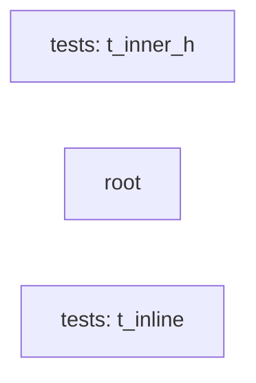

## Details

Static architecture map of 81 files (c, h, s, sh) in 3 components: tests: t_inner_h, root, tests: t_inline. Structure is extracted statically without LLM calls; component prose may be enriched locally.

### tests: t_inner_h (1)

tests: t_inner_h groups 3 files (c, h) around T_INNER_H, INNER_VAL, inner_add, T_OUTER_H, OUTER_VAL.

**Related Classes/Methods**:

- <a href="../tests/t_inner_h.h#L2-L3">tests/t_inner_h.h::T_INNER_H</a>
- <a href="../tests/t_inner_h.h#L4-L5">tests/t_inner_h.h::INNER_VAL</a>
- <a href="../tests/t_inner_h.h#L6-L10">tests/t_inner_h.h::inner_add</a>
- <a href="../tests/t_outer_h.h#L2-L5">tests/t_outer_h.h::T_OUTER_H</a>
- <a href="../tests/t_outer_h.h#L6-L8">tests/t_outer_h.h::OUTER_VAL</a>
- <a href="../tests/t_include.c#L5-L8">tests/t_include.c::main</a>

### root (2)

root groups 2 files (c, h) around MY_LIBRARY_H, greet, main, greet. Test function to verify that inclusion works correctly

**Related Classes/Methods**:

- <a href="../my_library.h#L2-L4">my_library.h::MY_LIBRARY_H</a>
- <a href="../my_library.h#L5-L7">my_library.h::greet</a>
- <a href="../test_include.c#L4-L9">test_include.c::main</a>
- <a href="../test_include.c#L10-L12">test_include.c::greet</a>

### tests: t_inline (3)

tests: t_inline groups 2 files (c, h) around T_INLINE_H, isq, icube, idbl, iinc.

**Related Classes/Methods**:

- <a href="../tests/t_inline_h.h#L2-L3">tests/t_inline_h.h::T_INLINE_H</a>
- <a href="../tests/t_inline_h.h#L4-L8">tests/t_inline_h.h::isq</a>
- <a href="../tests/t_inline.c#L4-L7">tests/t_inline.c::icube</a>
- <a href="../tests/t_inline.c#L8-L11">tests/t_inline.c::idbl</a>
- <a href="../tests/t_inline.c#L12-L15">tests/t_inline.c::iinc</a>
- <a href="../tests/t_inline.c#L16-L20">tests/t_inline.c::main</a>
